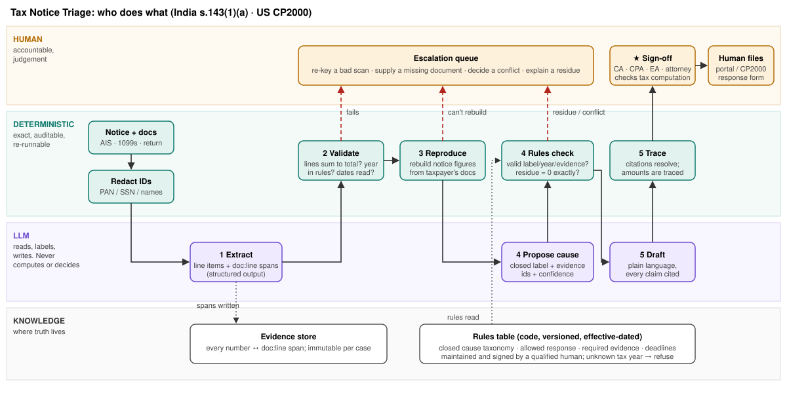

## 1. Area explored, and what surprised me

**Area:** income-tax *mismatch notices* sent to individuals: in India, communications of proposed adjustment under s.143(1)(a) from the Centralised Processing Centre; in the US, CP2000 notices from the IRS Automated Underreporter (AUR) program.

**What surprised me.**

1. **These notices are not judgements. They are the output of a join.** The tax authority matches third-party information (India: AIS / Form 26AS / Form 16; US: W-2 and 1099s) against the filed return, and anything that doesn't match becomes a proposed addition. Most wrong notices are therefore *join failures*: the income was reported on a different line or head, reported twice, under a payer's old name, without cost basis, or against the wrong PAN. The authority's matcher is exact but naive. A good response has to be just as exact, but it also has to understand *why* the join failed.
2. **Tax rules decay, and an LLM won't know.** The US 1099-K reporting threshold went from $20,000/200 transactions to $600 (2021), through years of transition relief, and back to $20,000/200 under the One Big Beautiful Bill Act (2025). India's dividend exemption under s.10(34) ended with the abolition of Dividend Distribution Tax in 2020. A model trained on older text will apply rules that no longer exist, and so do taxpayers. My test case IN-05 is built on exactly this.

## 2. Problem statement

- **Who**: Salaried and small-investor taxpayers, and the small-practice CAs (India) and EAs/CPAs (US) who handle their notices.
- **Task**: Read the notice → collect the taxpayer's documents → reconcile line by line → decide agree / disagree / partially agree → draft a cited response → file it within the deadline (30 days in India; the date printed on a CP2000, generally 30 days).
- **How often**: US: AUR closed 987,460 cases in FY2025 ($5.9B assessed) and 1.2M in FY2024 (IRS Data Book); ~3.5M CP2000s were issued in FY2007. India: I found **no consolidated official count**. CBDT has run AIS-mismatch e-campaigns, and 68,000 high-value cases were picked for e-verification for FY2019-20 alone. Volume is seasonal and arrives in waves after returns are processed.
- **Cost today**: Practitioner time per notice (*assumption to validate with practitioners: 1–3 hours, most of it spent reconciling rather than judging*). The larger cost is wrong outcomes: taxpayers **pay incorrect demands** because responding is hard, or **miss the window**. In India the adjustment is then made at processing; in the US an unanswered CP2000 leads to a statutory notice of deficiency and assessment.

**Why now.** AIS (launched 2021) greatly widened the third-party data India matches against, and every new data feed adds new ways for the join to fail. LLMs can now extract structured fields with source locations from messy PDFs well enough to be the *reading* layer, though not the deciding one.

**Out of scope:** scrutiny assessments and audits (s.143(2), field/office exams), penalty abatement, computing tax or interest, filing on the taxpayer's behalf, state and indirect taxes, business entities.

## 3. Solution design

**The core idea: reproduce the notice before explaining it.** The authority's notice came from a deterministic matcher, so the system first rebuilds the notice's own figures from the taxpayer's copies of the same documents, to the rupee or dollar. Only then does it try to explain each variance, and it accepts an explanation only if the cited evidence makes the remaining unexplained amount (the residue) exactly **zero**. If it can't reproduce the figures, it doesn't explain anything; if something is left over, it escalates. It never guesses.

| Stage | Data in | Who acts | Out |
|---|---|---|---|
| 0 Redact | Notice PDF, AIS/26AS/Form 16 or W-2/1099s, filed return | Code | PAN/SSN/names replaced by tokens before any model call |
| 1 Extract | Redacted docs | **LLM** (structured output) | Line items and records, *each with a `doc:line` span* |
| 2 Validate | Extracted items | Code | Lines sum to the stated total? Amounts parsed? Tax year covered by the rules table? Date readable? Fail → human re-keys |
| 3 Reproduce | Items + taxpayer records | Code (matcher on payer + category) | Notice figures rebuilt, or "cannot reproduce" → escalate |
| 4 Explain | Each variance | **LLM proposes** a label from a *closed taxonomy* + evidence IDs; **rules table decides** | Accepted amount = sum of cited records (never model arithmetic); residue must = 0 |
| 5 Draft | Accepted causes | **LLM** writes; code checks | Every citation must resolve; every currency amount must equal an extracted or computed figure |
| ★ Sign-off | Draft + flags | **Qualified human** | Signed position; the human files it. The system never submits |

**Exact versus probabilistic, and how they stay apart.** The LLM produces only three kinds of output, and each one is checked mechanically: (a) extracted values tied to spans, checked against the notice's own totals; (b) cause labels, which must exist in the rules table, be valid for that tax year, and cite real records whose amounts close the variance; (c) prose, whose citations and numbers are traced. The LLM never produces a number that ends up in the response unless that number already exists in a source document.

**Where knowledge lives.**

| Knowledge | Lives in | When it stops being valid |
|---|---|---|
| Facts about this taxpayer | Evidence store (spans) | Never; it describes a closed past year |
| Cause taxonomy, allowed responses, required evidence, exemptions, deadlines | **Rules table in code**: versioned, effective-dated, signed off by a qualified person | Edited by date range. A tax year the table hasn't been checked for is **refused**, not guessed |
| Reading messy documents, mapping names to entities, writing prose | LLM | Model upgrades are re-tested on the fixture set before release |
| Judgement (method of accounting, facts not in the documents, whether to dispute) | **Human reviewer** | — |

**Handling uncertainty and mistakes.** There are four hard gates (validate, reproduce, rules, trace) and two soft signals: model confidence below 0.65, and rules marked `judgement: true`. Hard-gate failures **withhold the draft**, so the reviewer isn't handed a polished paragraph that works around a hole. Soft signals become amber reviewer prompts. Every step writes to an append-only audit trail (rules version, model, spans, reviewer, decision).

**Why AI is necessary.** The inputs are heterogeneous PDFs and scans (CPC communications, broker statements, bank certificates, payment-app exports), and the *reason* a join failed is semantic: "Riverton Savings merged into Northfield", "rent offered under House Property", "memo: rent share". A template or rules approach can't read these, and it can't link a 1099 payer to an old name on Schedule B. On the other hand, a model can't be trusted with arithmetic or with rules that change, so it is limited to reading, labelling, and writing.

## 4. Alternatives I rejected

- **One LLM call: "here's the notice and documents, draft a reply."** Fluent and unauditable. It does arithmetic in prose, applies outdated rules (IN-05), and has no point where an unexplained residue would stop it.
- **RAG over the Income Tax Act / Internal Revenue Code.** Retrieval gives the model the text of a rule but leaves *applying* it probabilistic. The rules this task needs are few (about 6 labels per jurisdiction), change once a year, and must be exact, so a reviewed table is cheaper and auditable. RAG may come back later to explain long-tail causes to the reviewer, never to decide them.
- **Multiple cooperating agents.** No sub-task needs autonomy or negotiation, and agents talking to each other add more probabilistic hand-offs, the opposite of what an auditor wants.
- **Fine-tuning on notices.** The rules change every year, so a fine-tuned model would go stale faster than a table edit. There is also no public labelled data.
- **Auto-filing the response.** The liability belongs to the taxpayer and their representative, so the system drafts and a human files.

## 5. Risks

| Risk | How the design handles it | What remains |
|---|---|---|
| **Wrong answer** | Residue must be exactly 0; amounts come only from records; closed taxonomy; citation and amount trace; human sign-off | **The gate checks arithmetic, not meaning** (US-05): a model can cite a real line that already belongs to other income. Fix: an *evidence ledger* where each source line can explain only one amount (built into the mock as a toggle; it catches US-05 with no false positives across all 12 cases). |
| **Outdated rules** | Effective-dated rules table; years it doesn't cover are refused; LLM labels are re-checked against the table (IN-05) | The table is only as current as its maintainer. Needs a named owner and an annual review before filing season. |
| **Confidential data** | Redaction before model calls; option to run on a model with no data retention or self-hosted; case data kept per tenant; no training on client documents | OCR'd scans may leak identifiers that redaction misses. Run redaction on the OCR text as well and spot-check it. |
| **Liability / advice** | It's a tool for the practitioner, not advice to the consumer. US: representing a taxpayer before the IRS requires a Circular 230 practitioner (CPA/EA/attorney) with Form 2848. India: the taxpayer or an authorised representative (s.288) responds; a CA isn't legally required, but I treat CA review as the product default because the responder carries the consequences. In a consumer mode, the system would only *explain* and would not recommend a position. | Automation bias: reviewers may rubber-stamp. Hard gates withhold drafts entirely, and a sample of signed cases should be re-reviewed. |
| **Missed deadline** | Deadline computed by rule (IN: issue date + 30) or read from the notice (US) and shown on every screen | An unreadable date (IN-06) becomes "unknown", which the reviewer must resolve first. |

## 6. Proof: clickable mock and 12 synthetic cases

The mock (`mock/index.html`) **runs the deterministic stages live** (validation, reproduction, rules engine, ledger guard, citation and amount tracing). The LLM stages are **canned fixtures**: no model was called. So this tests the scaffolding and the design, **not** extraction accuracy on real documents, which is the largest untested assumption. All data is made up.

| Result | Cases |
|---|---|
| Correct, closed automatically | IN-01 duplicate AIS, IN-02 different head |
| Correct, closed but sent to reviewer | IN-04 wrong PAN (weak evidence), US-01 missing basis → partial agree, US-03 renamed payer |
| Correct, stopped or escalated | IN-03 TDS-credit conflict, IN-05 repealed exemption caught, IN-06 bad scan, US-02 $2,400 residue, US-06 needs prior-year return |
| **Wrong** | **US-04**: agreed in full and missed ~$1,450 of Schedule C expenses (the taxonomy only looks at income). **US-05**: v1 accepted reused evidence; the ledger guard fixes it. |

Details for each case are in `examples/results.md`.

## 7. Jurisdictions: India and US

| | India | US |
|---|---|---|
| Notice | s.143(1)(a) communication (CPC) | CP2000 (AUR) |
| Third-party data | AIS, Form 26AS, Form 16/16A | W-2, 1099-INT/DIV/B/K/NEC/G |
| Deadline | 30 days from the communication | Date printed on the notice |
| Response channel | e-Proceedings on the e-filing portal; AIS feedback | CP2000 response form, by mail or fax / online where offered |
| Who may respond | Taxpayer or authorised representative | Taxpayer, or a Circular 230 practitioner with Form 2848 |

**India's new Act.** The Income-tax Act 2025 applies from tax year 2026-27; s.143(1) appears to map to s.270 *(secondary sources; verify against the enacted text)*. Notices for earlier years stay under the 1961 Act, so this becomes a new effective-dated version of the rules table, not a redesign.

**For another jurisdiction**, the pipeline, gates and UI stay the same. What changes is the rules table (labels, deadlines, exemptions), the extraction schemas for its notice and information returns, and the reviewer roles. That is a deliberate consequence of keeping knowledge in the table and not in the model.

## 8. Before spending more time on this

1. **Get 20–30 real, redacted notices** from practitioners and measure the share the closed taxonomy can explain. If it's under ~70%, the design's value drops.
2. **Measure extraction on real scans**, especially CPC PDFs and broker statements. This is the weakest link I haven't tested.
3. **Time-and-motion with 3 practitioners** in each country to replace the 1–3 hour assumption with data.
4. **Check existing products.** Indian filing platforms already show AIS-vs-ITR comparisons, so what exactly does this add beyond them?
5. **Add the missing rules** found in testing: an evidence ledger, and a "related deductions?" prompt whenever the label is genuinely omitted business income.

*Appendix (one page): see `appendix.md`.*
